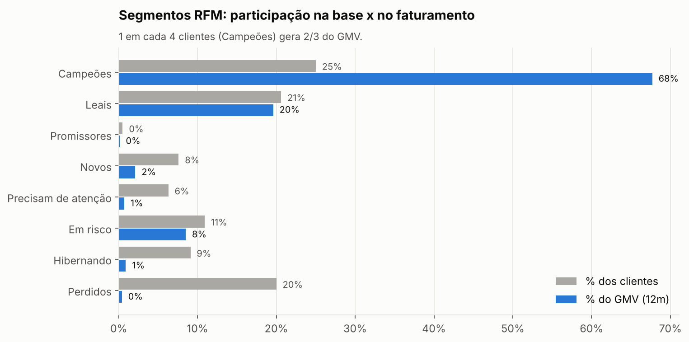
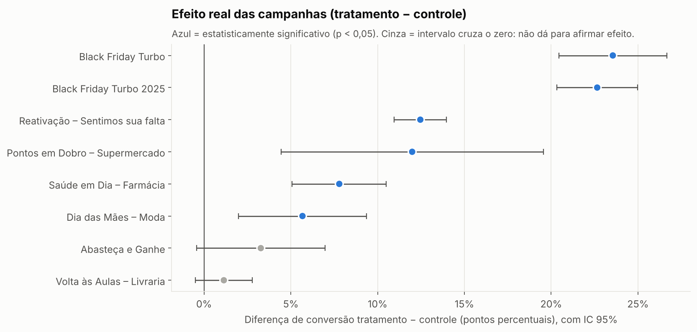
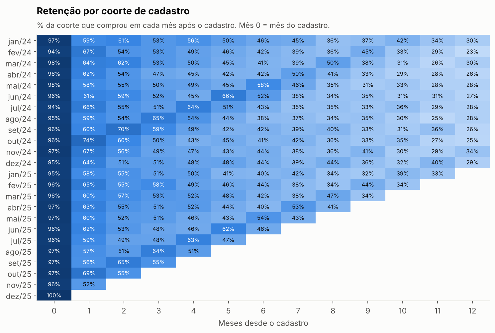
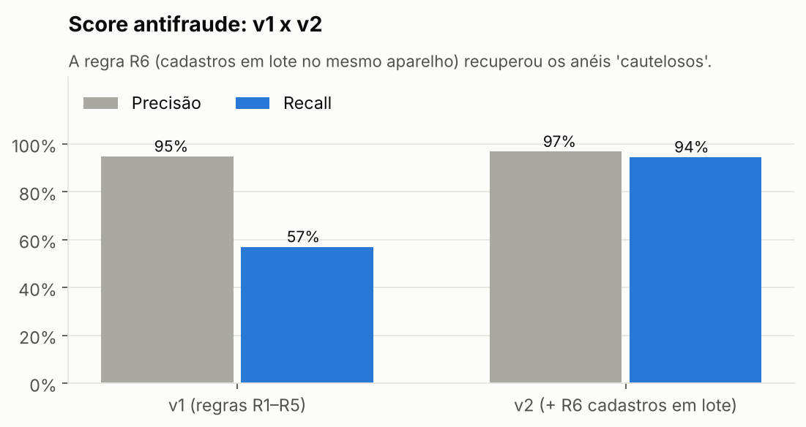
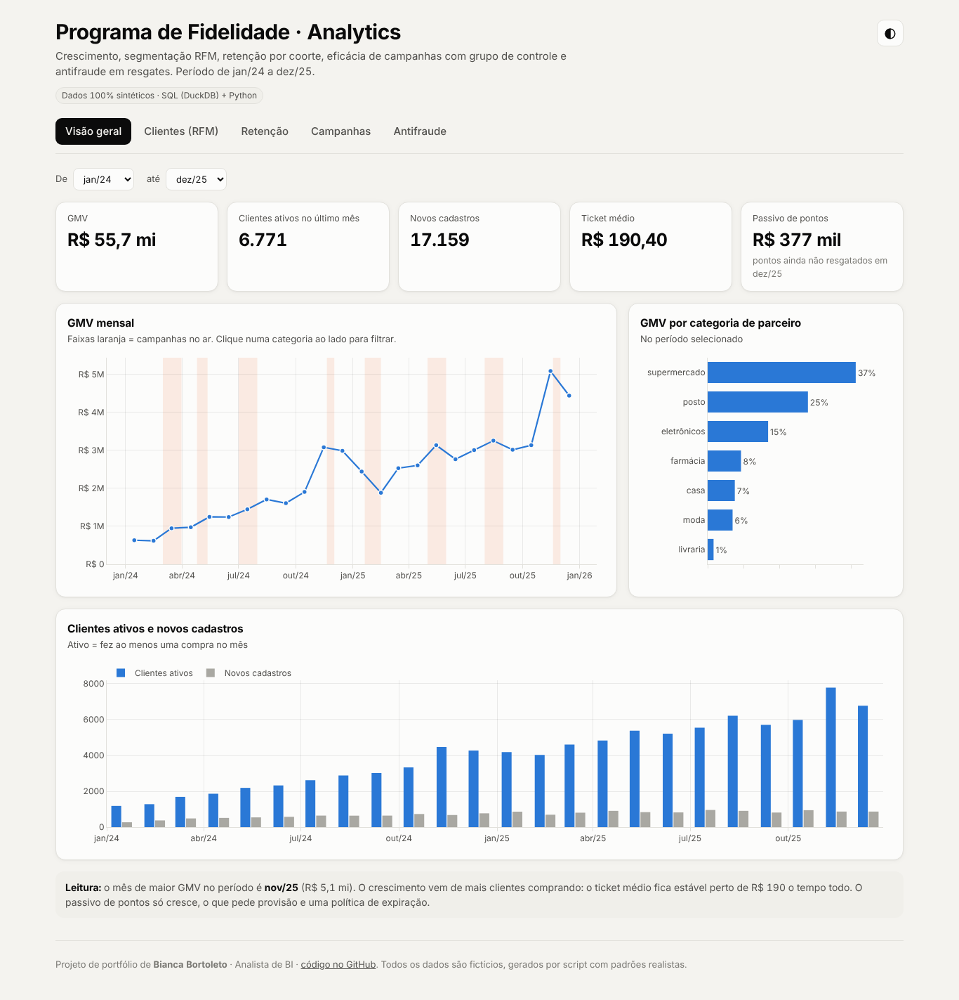
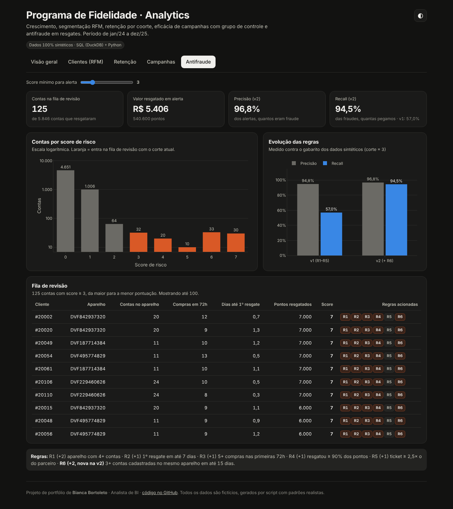
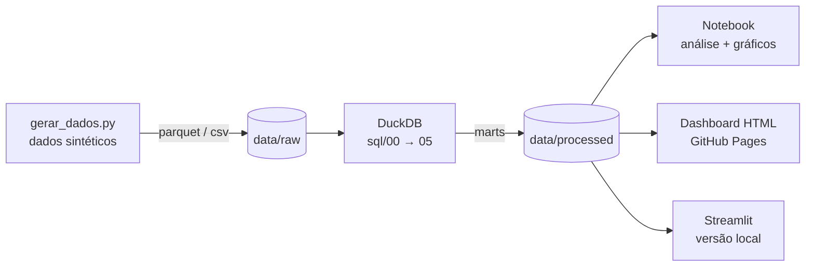

# 📊 Fidelidade Analytics

**Análise ponta a ponta de um programa de fidelidade de varejo** — da geração dos dados ao dashboard —
respondendo às perguntas que um time de BI de fidelidade enfrenta no dia a dia:
*o programa está crescendo? quem são os clientes que importam? as campanhas funcionam de verdade? tem fraude nos resgates?*


>  **Todos os dados são sintéticos**, gerados por [`src/gerar_dados.py`](src/gerar_dados.py) com padrões realistas
> (sazonalidade, churn, campanhas com grupo de controle e anéis de fraude). Nenhum dado real de empresa ou cliente foi usado.

🔗 **[Abrir o dashboard interativo](https://bortoleto12.github.io/fidelidade-analytics/)** · 📓 **[Ver o notebook com a análise completa](notebooks/analise_programa_fidelidade.ipynb)**

---

## Principais resultados

| Pergunta | Resposta |
|---|---|
| **O programa está crescendo?** | GMV **dobrou** de 2024 para 2025 (R$ 18 mi → R$ 37 mi), puxado por mais clientes ativos — o ticket médio ficou estável em ~R$ 190. |
| **Quem importa?** | **1 em cada 4 clientes (Campeões) gera 2/3 do faturamento.** O segmento "Em risco" ainda carrega ~9% do GMV e é o melhor alvo de reativação. |
| **Os clientes ficam?** | A maior perda é no **1º mês** (~4 em 10 não voltam). Clientes vindos de **indicação** retêm 17 p.p. a mais que os do site no 6º mês. |
| **As campanhas funcionam?** | **Reativação** teve ROI de ~8x. **Black Friday** traz o maior volume, mas ROI de só ~2,5x (pontos em triplo + público que compraria de qualquer jeito). **2 de 8 campanhas não tiveram efeito estatisticamente comprovado.** |
| **Tem fraude?** | Score por regras v1 pegava 57% das fraudes. Analisando os casos que escaparam, criei a regra R6 (cadastros em lote no mesmo aparelho) → **recall de 94,5% com 96,8% de precisão**. |

<p align="center">
  
  
</p>
<p align="center">
  
  
</p>

## 🖥️ Dashboard interativo (HTML)

Um único arquivo HTML ([`docs/index.html`](docs/index.html)), publicado no **GitHub Pages**: abre direto no navegador,
sem servidor e sem instalar nada. Tem cinco abas (Visão geral, Clientes RFM, Retenção, Campanhas e Antifraude) com:

- filtro de período com comparação automática contra o período anterior
- **filtro cruzado**: clicar numa categoria de parceiro filtra a curva de GMV
- segmentação RFM filtrável por canal de aquisição e faixa etária
- opção de ver só as campanhas com efeito estatisticamente comprovado
- corte de score ajustável que atualiza a fila de revisão de fraude em tempo real
- modo claro/escuro e layout que funciona no celular

<p align="center">
  
  
</p>

> Também há uma versão em **Streamlit** (`app/app.py`) para quem quiser explorar os dados com Python rodando localmente.

## Arquitetura



| Camada | O que tem |
|---|---|
| [`sql/00_staging.sql`](sql/00_staging.sql) | Tipagem e camada base |
| [`sql/01_kpis_mensais.sql`](sql/01_kpis_mensais.sql) | GMV, ativos, ticket, frequência, **passivo de pontos** acumulado (window functions) |
| [`sql/02_rfm.sql`](sql/02_rfm.sql) | Notas R/F/M com `NTILE(5)` e regras de segmentação |
| [`sql/03_coortes.sql`](sql/03_coortes.sql) | Matriz de retenção por coorte + retenção por canal |
| [`sql/04_campanhas.sql`](sql/04_campanhas.sql) | **Teste A/B**: conversão tratamento x controle, uplift, **teste z**, GMV incremental, ROI |
| [`sql/05_antifraude.sql`](sql/05_antifraude.sql) | Score de risco com 6 regras explicáveis (v1 x v2) |

## O modelo de dados

```
clientes ──< transacoes >── parceiros
   │              │
   │              └──── campanhas ──< campanha_publico (tratamento | controle)
   └──< resgates >── catalogo_premios
```

~20 mil clientes · ~300 mil transações · 10 parceiros · 8 campanhas · ~16 mil resgates · 2024–2025

## Como rodar

```bash
git clone https://github.com/bortoleto12/fidelidade-analytics.git
cd fidelidade-analytics
python -m venv .venv && source .venv/bin/activate   # Windows: .venv\Scripts\activate
pip install -r requirements.txt

python src/gerar_dados.py      # 1. gera os dados sintéticos (~40s)
python src/pipeline.py         # 2. roda o SQL, exporta os marts e gera docs/index.html
open docs/index.html           # 3. abre o dashboard (Windows: start docs\index.html)
streamlit run app/app.py       # (opcional) versão Streamlit
jupyter notebook notebooks/    # (opcional) explora a análise
```

## Decisões que valem destacar

- **Grupo de controle em toda campanha.** Sem ele, o "resultado" da Black Friday incluiria quem compraria de qualquer jeito.
  O controle mostrou que ~45% do público converteria sem a oferta.
- **ROI sem significância não é resultado.** "Abasteça e Ganhe" tem ROI aparente de ~4x, mas p ≈ 0,10 — não dá para atribuir o efeito à campanha.
- **Regras explicáveis antes de modelos.** No antifraude, cada alerta precisa ser justificável para o time de prevenção.
  O gabarito dos dados sintéticos permitiu medir precisão e recall e iterar a regra com base nos falsos negativos.
- **Falsos positivos realistas.** Famílias que dividem um celular e totens de autoatendimento em loja foram simulados
  de propósito, para garantir que as regras não punem clientes legítimos.

## Próximos passos

- Modelo de propensão a churn para antecipar o segmento "Em risco"
- CLV (valor do tempo de vida) por canal de aquisição
- Detecção de anéis de fraude via grafo (contas ↔ dispositivos ↔ parceiros)

---

**Bianca Bortoleto** · Analista de BI
[LinkedIn](https://www.linkedin.com/in/bianca-bortoleto-83b620142/) · [GitHub](https://github.com/bortoleto12)
